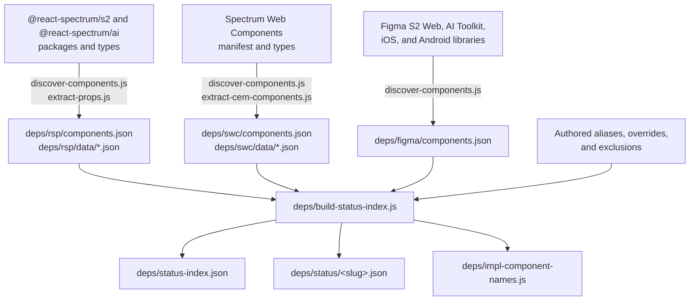

# Dependencies and generated data

The `deps/` directory contains more than third-party libraries. It also contains
generated component catalogs, authored mapping inputs, build scripts, and data
contracts consumed by blocks. Treat each category differently.

## Directory categories

| Category | Examples | Change policy |
| --- | --- | --- |
| Vendored browser dependencies | `deps/lit/`, `deps/turndown/`, `deps/components/` | Edit the source entry, then rerun the corresponding `npm run build:*` script |
| Authored runtime components | `deps/se/` | Edit the source in place; there is no upstream package or build step |
| Extraction source data | `deps/rsp/data/`, `deps/swc/data/`, `deps/figma/components.json` | Regenerate from upstream sources |
| Authored mappings and overrides | `component-aliases.json`, `status-overrides.json`, `roster-excludes.json` | Edit intentionally, then rebuild |
| Generated status outputs | `status-index.json`, `status/<slug>.json`, `impl-component-names.js` | Never hand-edit |
| Extraction/build code | `deps/rsp/*.js`, `deps/swc/*.js`, `deps/shared/`, `build-status-index.js` | Change with tests and regenerate outputs |
| Playground/runtime assets | `deps/rsp/playground/`, `deps/swc/components.json` | Follow the subsystem contract |

Do not assume that everything under `deps/` is safe to replace with an npm
package or safe to edit as source. [`deps/README.md`](../deps/README.md) describes
the vendored dependency layouts. Component entries live under
`deps/components/src/<name>/index.js`. Run `npm run build:components` to bundle
them into `deps/components/dist/<name>/index.js` and generate an import-only
`deps/components/dist/index.js`. Prefer individual component imports in blocks
to avoid loading unused components.

## Component data flow

Spectrum Hub combines code implementation data from React Spectrum (RSP) and
Spectrum Web Components (SWC) with design data from the Figma S2 Web, Spectrum AI
Toolkit, iOS, and Android libraries:



The generated outputs feed:

| Consumer | Reads |
| --- | --- |
| `blocks/status-table/` | `deps/status-index.json`, filtered to components with web cells |
| `blocks/component-status/` | Canonical `deps/status/<slug>.json` slices for automatically generated status pills |
| `scripts/utils/figma.js` | The same canonical slices for each requested platform's selected source/file/node reference |
| `scripts/utils/go-to-impl.js` | Canonical status slices to gate automatic actions; `deps/impl-component-names.js` for documentation names, native page aliases, packages, and SWC Storybook sections |
| `blocks/playground/` | `deps/impl-component-names.js` for export names, plus the raw `deps/rsp/data` and `deps/swc/data` catalogs |

In automatic mode, `component-status`, `figma.js`, and `go-to-impl.js` use
`fetchComponentPageSlice` in `scripts/utils/component-slice.js`. Fetches are
memoized per canonical slug for the page's lifetime. Shared mobile pages can
combine two slices: Snackbars and toasts reads iOS from `toast.json` and Android
from `snackbar.json`. The Design consumers see the same override-resolved
references, so a `figmaPageSource` override applies to the Figma action and
Design pill alike.

Authored status rows bypass generated status and link resolution.
`scripts/utils/authored-status.js` supplies the shared row models to
`component-status` and `page-nav`. Their authored resources replace the entire
automatic implementation and Figma action set, even when no linked or
audience-visible rows remain. Design pills and actions still follow the
private-audience rules. Empty blocks and pages without authored rows retain
automatic resolution. See
[Authored component status](./CONTENT_AUTHORING.md#authored-component-status)
for the row format and precedence rules.

Mobile page aliases and native documentation names are authored at the
`ios`/`android` platform level in `deps/status-overrides.json`, outside the
`figma` cell. Set `page` for the DA slug, `upstreamName` for a different
documentation symbol, and `package` when Android's documentation package differs
from that symbol. Rebuild to generate the native `canonical`, `docs`, and
`package` entries in `deps/impl-component-names.js`. Canonical status filenames
remain unchanged; `scripts/utils/component-slice.js` resolves their page aliases.

Native naming metadata does not add code availability cells. Native documentation
URLs are built in `scripts/utils/go-to-impl.js`. Native Code documentation pills
require that platform to be present in the resolved status data.
Automatic implementation actions require a
successfully fetched status slice. A 404 or another fetch failure removes the
affected action. Shared mobile pages check each platform separately, so a
missing Android slice does not hide an iOS action whose slice exists. This
uses the cached data, not rendered pill DOM; Copy markdown and authored links
are unaffected.

Native documentation URLs are still assembled from route rules, not checked
against a native documentation catalog. A status slice does not establish that
the upstream documentation destination exists. See
[Status and link mappings](../deps/docs/STATUS-FILES.md) for the route rules,
native naming exceptions, and excluded pattern-child limitations.

Status consumers should read the generated model, not independently reinterpret
raw RSP, SWC, or Figma status values. The playground intentionally reads raw
RSP/SWC prop catalogs because it needs property-level control metadata that is
not part of the combined status model.

## Authored inputs

Edit these files for intentional re-mappings:

| File | Purpose |
| --- | --- |
| `deps/component-aliases.json` | Reconciles source-specific names with canonical component names and documentation names |
| `deps/status-overrides.json` | Overrides status or link data; supplies platform-level native page and documentation naming metadata |
| `deps/roster-excludes.json` | Removes composition parts from web membership without excluding native designs |
| `scripts/utils/figma-sources.js` | Registers Figma library identity and platform |
| `deps/rsp/rsp-secondary-status.json` | Adds RSP guidance below a primary status |
| `deps/swc/swc-secondary-status.json` | Adds SWC guidance below a primary status |
| `deps/figma/figma-secondary-status.json` | Adds web Figma guidance and contributes names to web Figma membership; does not supply node references |

After editing any of these, regenerate and inspect the combined outputs:

```bash
node deps/build-status-index.js
npm run test:extractions
```

## Generated files

Never hand-edit:

- `deps/status-index.json`
- `deps/status/<slug>.json`
- `deps/impl-component-names.js`
- `deps/rsp/components.json`
- `deps/rsp/data/*.json`
- `deps/swc/components.json`
- `deps/swc/data/*.json`
- `deps/figma/components.json`

Only `deps/impl-component-names.js` carries a marker, because it is the one generated
output in the list above that can hold a comment:

```js
// Generated by deps/build-status-index.js — do not edit by hand.
```

Every other path above is JSON, which cannot. Treat the list itself as the authority on
what is generated rather than looking for a header inside the file.

When generated output looks wrong, fix the authored mapping, extractor, status
model, or upstream source that produced it. A direct output edit will disappear
on the next scheduled extraction.

## React Spectrum extraction

`deps/rsp/` discovers components from `@react-spectrum/s2` and
`@react-spectrum/ai`, follows their TypeScript declaration graphs, and uses the
TypeScript checker (`deps/rsp/build-ts-checker.js`) to resolve inherited props,
unions, and `Omit`/`Pick` behavior.

Run:

```bash
node deps/rsp/discover-components.js
node deps/rsp/extract-props.js
node deps/build-status-index.js
npm run test:extractions
```

The extraction fetches published package files and can take several minutes.
`discover-components.js` rewrites the generated roster; `extract-props.js`
rewrites per-component data and removes stale files with a fail-closed roster
size guard.

Read [`deps/rsp/README.md`](../deps/rsp/README.md) before changing type
resolution, package crawling, component discovery, or playground naming.

## Spectrum Web Components extraction

`deps/swc/` reads the published second-generation SWC Custom Elements Manifest
and resolves attribute types against the package's TypeScript declarations (`deps/swc/build-ts-checker.js`).

Run against the published manifest:

```bash
node deps/swc/discover-components.js
node deps/swc/extract-cem-components.js
node deps/build-status-index.js
npm run test:extractions
```

Both scripts also accept a local CEM path when validating unreleased SWC work.
Published extraction follows the `latest` distribution tag and records its
resolved concrete version in `deps/swc/version.json`. Read
[`deps/swc/README.md`](../deps/swc/README.md) before changing version or source
handling.

## Figma discovery

Figma discovery reads the libraries registered in
`scripts/utils/figma-sources.js`: S2 Web, Spectrum AI Toolkit, S2 iOS, and
S2 Android. With `FIGMA_TOKEN` stored in an existing ignored `.env` file:

```bash
node --env-file=.env deps/figma/discover-components.js
node deps/build-status-index.js
```

Every source must return validated published component sets before the roster
is atomically replaced. Index generation then resolves source-qualified aliases
and explicit selections within each platform. Native design availability does
not imply native code support or create web-table rows.

Read [deps/figma/README.md](../deps/figma/README.md) for credential scope, file
access, selection rules, and the scheduled and manually dispatched read-only
Actions validation workflow.

## Combined status build

`deps/build-status-index.js`:

1. reads RSP, SWC, and Figma rosters and authored configuration
2. excludes internal SWC components and reviewed web composition parts
3. resolves canonical names and platform-specific Figma selections
4. maps source-specific states to the unified status vocabulary
5. applies secondary guidance and manual status overrides
6. attaches selected source/file/node references
7. writes the complete index, platform-specific slices, and name map

Run it directly:

```bash
node deps/build-status-index.js
```

Review both the expected component and unexpected neighboring changes. Alias and
status-model edits can affect many rows.

## Data contracts

The detailed contracts under `deps/docs/` are authoritative for the generated
models:

| Document | Read it when |
| --- | --- |
| [`STATUS-FILES.md`](../deps/docs/STATUS-FILES.md) | Choosing which mapping/status file to edit or tracing an output |
| [`DATA-CONTRACT.md`](../deps/docs/DATA-CONTRACT.md) | Changing source status vocabularies or the unified status model |
| [`PLAYGROUND-CONTRACT.md`](../deps/docs/PLAYGROUND-CONTRACT.md) | Changing property controls, snippets, component names, or playground lookups |
| [`REMOVED-DETECTION.md`](../deps/docs/REMOVED-DETECTION.md) | Changing how removed components are detected |

`deps/impl-component-names.js` has optional canonical-component, documentation,
export, package, and Storybook-section metadata. Its name fields are not
interchangeable:

- `canonical` identifies the component whose status slice a native page alias reads.
- `docs` names the page the implementation's own documentation site publishes it on. It
  is many-to-one: RSP's `AlertDialog`, `Dialog`, and `FullscreenDialog` all link to
  `Dialog.html`.
- `export` names what to import and render. It is one-to-one: `FullscreenDialog` is its
  own component even though its docs redirect to `Dialog`'s page.

Use `docs` to build a documentation link and `export` to name the component in
code.

`package` selects RSP's S2 or shared AI documentation route, or Android's
documentation package suffix. `docsSection` selects SWC's ordinary component or
AI Toolkit pattern group in Storybook.
Neither field changes the component's status implementation.

## Automation

GitHub workflows regenerate upstream-derived RSP and SWC data on a schedule,
commit changes to bot-owned branches, and create or update pull requests. The
status build runs after source extraction so each pull request keeps the source
data and combined outputs synchronized.

Figma validation runs daily at 08:15 UTC and supports manual dispatch through
`.github/workflows/validate-figma-discovery.yml`. It requires `FIGMA_TOKEN`,
runs default-branch code, and reports generated changes without committing,
pushing, or opening a pull request. Use local authenticated discovery to validate
an unmerged feature branch.

When an automation diff is unexpectedly large:

1. Check whether the upstream package or manifest changed.
2. Read extractor warnings.
3. Run `npm run test:extractions`.
4. Inspect roster additions/removals and several representative property files.
5. Rebuild the combined status index locally.
6. Do not mask the change with manual edits to generated output.

## Safe change checklist

1. Identify whether the target is authored, generated, vendored, or build logic.
2. Read the owning README/data contract.
3. Edit the source of truth.
4. Run the exact regeneration command.
5. Run `npm run test:extractions`.
6. Review generated additions, removals, and renames.
7. Include source and regenerated outputs in the same change.

## Related guides

- [Architecture](./ARCHITECTURE.md)
- [Blocks](./BLOCKS.md)
- [Tests](./TESTS.md)
- [Tools](./TOOLS.md)
